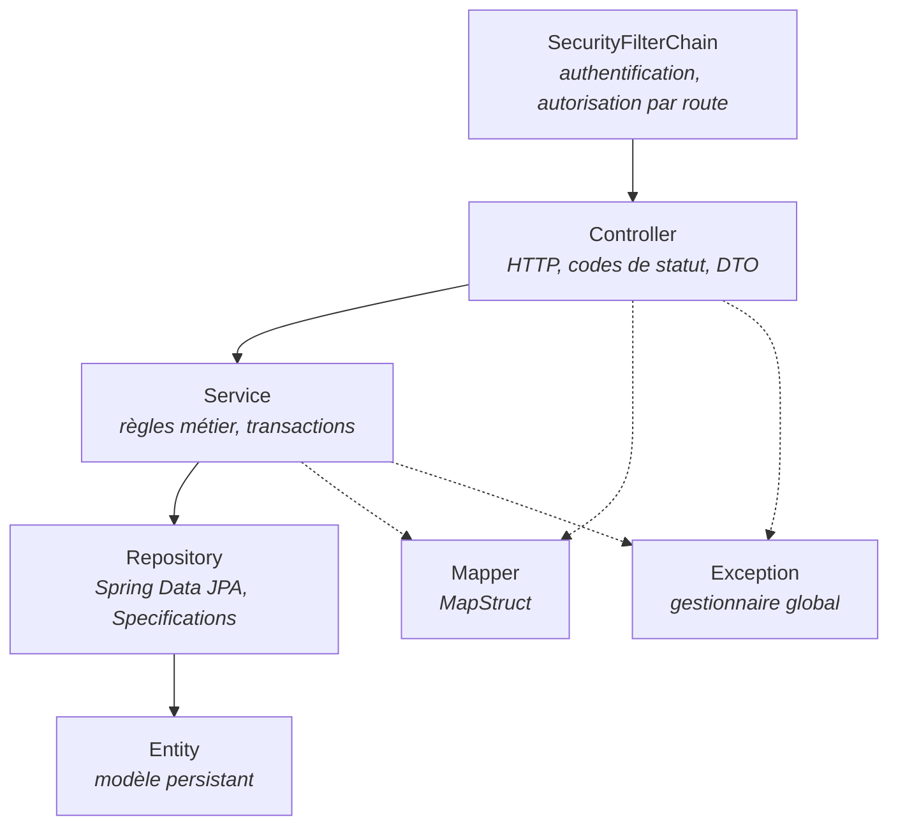

# biblio1-api

[](https://github.com/Japha-Fomen/biblio1-api/actions/workflows/ci.yml)

API REST de gestion de bibliothèque écrite en **Java 21** et **Spring Boot 4.1**, sécurisée par rôles, conteneurisée et déployée.

**Service en ligne : [biblio1-api-1072215005062.us-east4.run.app](https://biblio1-api-1072215005062.us-east4.run.app)**

Le catalogue est public, aucun compte n'est nécessaire pour le consulter :
[tous les livres](https://biblio1-api-1072215005062.us-east4.run.app/api/livres?size=5) ·
[recherche par genre](https://biblio1-api-1072215005062.us-east4.run.app/api/livres/recherche?genre=ESSAI) ·
[auteurs](https://biblio1-api-1072215005062.us-east4.run.app/api/auteurs) ·
[état du service](https://biblio1-api-1072215005062.us-east4.run.app/actuator/health)

*L'instance et la base se mettent en veille après une période d'inactivité. Le premier appel peut prendre jusqu'à une minute, le temps que les deux redémarrent. Les données, elles, persistent.*

Projet d'apprentissage construit seul, de bout en bout : modèle JPA, couche de service portant les règles métier, contrôleurs REST, validation des entrées, gestion centralisée des erreurs, sécurité par rôles, migrations de schéma versionnées, intégration continue et déploiement par conteneur.

> **État du projet : étape 1 sur 3.**
> Cette version met en place une **architecture en couches** classique (`Controller → Service → Repository → Entity`). C'est volontairement le point de départ. La suite est décrite dans la [feuille de route](#feuille-de-route).

---

## Sommaire

- [Feuille de route](#feuille-de-route)
- [Pile technique](#pile-technique)
- [Architecture actuelle](#architecture-actuelle)
- [Modèle de domaine](#modèle-de-domaine)
- [Sécurité](#sécurité)
- [Démarrage](#démarrage)
- [Configuration](#configuration)
- [Migrations de schéma](#migrations-de-schéma)
- [Endpoints](#endpoints)
- [Tests](#tests)
- [Intégration continue et déploiement](#intégration-continue-et-déploiement)
- [Conventions de code](#conventions-de-code)
- [Limites connues](#limites-connues)
- [English summary](#english-summary)

---

## Feuille de route

Le projet sert de support à un apprentissage progressif de l'écosystème Spring. Chaque étape est une refonte assumée de la précédente, pas un ajout de fonctionnalités.

### Étape 1 : Architecture en couches *(actuelle)*

Découpage technique horizontal. Les entités JPA traversent l'application et les règles métier vivent dans les services. Objectif : maîtriser Spring Boot, Spring Data JPA, la validation, le mapping DTO, la configuration par profils, la sécurité par rôles, les migrations de schéma et la livraison.

### Étape 2 : Modèle domaine / service *(à venir)*

Passage à un découpage vertical par domaine métier. Le modèle de domaine devient indépendant de JPA, les règles quittent les services applicatifs pour les objets métier, et la persistance passe derrière des interfaces. Objectif : inverser la dépendance entre le métier et l'infrastructure.

### Étape 3 : Microservices *(à venir)*

Décomposition en services autonomes, catalogue, membres et emprunts, avec base de données par service, communication inter-services, configuration distribuée et découverte de services via Spring Cloud.

---

## Pile technique

| Domaine | Choix |
|---|---|
| Langage | Java 21 |
| Framework | Spring Boot 4.1.0 |
| Web | Spring Web MVC |
| Sécurité | Spring Security, authentification HTTP Basic sans session, hachage BCrypt |
| Persistance | Spring Data JPA, Hibernate, JPA Specifications |
| Migrations | Flyway, scripts versionnés par moteur |
| Base de données | MySQL 8 en développement, PostgreSQL géré en déploiement |
| Validation | Jakarta Bean Validation |
| Mapping | MapStruct 1.5.5 |
| Supervision | Spring Boot Actuator |
| Build | Maven (wrapper inclus) |
| Conteneurisation | Docker, image en deux étapes, environ 200 Mo |
| Intégration continue | GitHub Actions |
| Hébergement | Google Cloud Run, région `us-east4` |

---

## Architecture actuelle



La chaîne de filtres s'exécute **avant** le `DispatcherServlet`. C'est pourquoi une exception levée pendant l'authentification ne passe jamais par le gestionnaire global, qui appartient à Spring MVC.

```
src/main/java/com/example/biblio1_api
├── Config/        ConfigurationSecuriteClassique : chaîne de filtres, encodeur de mots de passe
│                  ProprietesBiblio : configuration métier typée et validée
├── Controller/    Auteur, Livre, Membre, Emprunt, Utilisateur
├── Dto/           requêtes de création et de mise à jour, réponses, projections, ErrorResponse
├── Entity/        Auteur, Livre, Membre, Emprunt, Utilisateur
│                  + énumérations Genre, StatutEmprunt, Role
├── Exception/     RessourceIntrouvableException, ConflitMetierException,
│                  RequeteInvalideException, GlobalExceptionHandler
├── Mapper/        mappers MapStruct générés à la compilation
├── Repository/    dépôts Spring Data + LivreSpecification (recherche dynamique)
└── Service/       Auteur, Livre, Membre, Emprunt, RechercheLivre, Utilisateur
                   UserDetailService : chargement des comptes pour Spring Security
```

---

## Modèle de domaine

| Entité | Rôle | Relations |
|---|---|---|
| `Auteur` | Auteur d'un ou plusieurs livres | 1 vers N `Livre` |
| `Livre` | Ouvrage du catalogue, identifié par un ISBN unique | N vers 1 `Auteur`, 1 vers N `Emprunt` |
| `Membre` | Personne inscrite à la bibliothèque, identifiée par un courriel unique | 1 vers N `Emprunt`, 0..1 vers 1 `Utilisateur` |
| `Emprunt` | Prêt d'un livre à un membre, avec date de retour et statut | N vers 1 `Livre`, N vers 1 `Membre` |
| `Utilisateur` | Compte d'accès à l'API, porteur d'un ou plusieurs rôles | 1 vers 0..1 `Membre` |

Énumérations : `Genre`, `StatutEmprunt` et `Role`.

**`Utilisateur` et `Membre` sont deux notions distinctes.** Un `Utilisateur` est une identité qui s'authentifie ; un `Membre` est une fiche de bibliothèque qui emprunte. Le rattachement est facultatif et porté par `membre.utilisateur_id` : un bibliothécaire doit pouvoir inscrire au comptoir une personne qui n'a pas de compte en ligne, et un compte peut exister sans fiche de membre.

Les règles de prêt sont externalisées dans la configuration et injectées via `ProprietesBiblio` : nombre maximal d'emprunts simultanés, durée du prêt, nombre d'exemplaires à l'enregistrement, pénalités par type de membre.

---

## Sécurité

Authentification **HTTP Basic sans session**, mots de passe hachés en **BCrypt** avec un coût de 12, autorisation par rôles appliquée route par route dans une `SecurityFilterChain` unique.

| Rôle | Peut |
|---|---|
| *(aucun compte)* | Consulter le catalogue, livres et auteurs. Créer un compte |
| `LECTEUR` | Consulter et modifier son compte, emprunter, consulter ses emprunts |
| `BIBLIOTHECAIRE` | Gérer le catalogue et les membres, constater les retours |
| `ADMIN` | Attribuer et retirer les rôles, consulter l'annuaire des comptes |

Trois décisions méritent d'être expliquées.

**L'ordre des règles est la protection.** Spring Security retient la première règle qui correspond. Les règles spécifiques passent donc avant les générales : sans cela, un `GET /api/**` ouvert exposerait la liste des membres avec leurs courriels. Les routes publiques sont énumérées une par une plutôt que couvertes par un motif large.

**L'inscription est publique et n'accorde que le rôle lecteur.** Le rôle est fixé côté serveur, il n'est jamais lu depuis le corps de la requête.

**L'attribution des rôles est réservée à l'administrateur**, ce qui empêche un bibliothécaire de se promouvoir lui-même.

Le changement de mot de passe exige l'ancien, et les contrôles sont ordonnés de façon à ne jamais révéler si une valeur proposée correspond au mot de passe courant avant que l'identité de l'appelant soit vérifiée.

---

## Démarrage

### Prérequis

- JDK 21
- Une base MySQL 8 locale nommée `biblio1_db` pour le profil `test`
- Aucune installation de Maven : le wrapper est fourni

### Lancer l'application

```bash
git clone https://github.com/Japha-Fomen/biblio1-api.git
cd biblio1-api/biblio1-api

# Profil dev : base H2 en mémoire, aucune variable requise
./mvnw spring-boot:run -Dspring-boot.run.profiles=dev
```

Sous Windows, remplacer `./mvnw` par `mvnw.cmd`.

Pour le profil `test`, qui vise MySQL, trois variables d'environnement sont nécessaires :

```bash
export DB_URL=jdbc:mysql://localhost:3306/biblio1_db
export DB_USERNAME=votre_utilisateur
export DB_PASSWORD=votre_mot_de_passe
./mvnw spring-boot:run
```

### Lancer par conteneur

Depuis la **racine du dépôt**, pas depuis le module. Le `Dockerfile` attend la racine comme contexte de construction :

```bash
docker build -t biblio1-api .
docker run -p 8080:8080 \
  -e SPRING_PROFILES_ACTIVE=dev \
  biblio1-api
```

### Vérifier que le service répond

```bash
curl http://localhost:8091/actuator/health
```

---

## Configuration

Les profils sont définis dans `src/main/resources`. En déploiement, le profil actif est imposé par la variable d'environnement `SPRING_PROFILES_ACTIVE`, qui l'emporte sur le fichier.

| Profil | Base de données | Schéma | Port |
|---|---|---|---|
| `dev` | H2 en mémoire, console activée, SQL journalisé | `create-drop` | 8091 |
| `test` | MySQL 8 via `DB_URL`, `DB_USERNAME`, `DB_PASSWORD` | Flyway, puis `validate` | aléatoire |
| `cloudrun` | PostgreSQL via `DB_URL1`, `DB_USERNAME1`, `DB_PASSWORD1` | Flyway, puis `validate` | fourni par la plateforme (`PORT`) |

Le profil `demo` s'active **en complément** d'un autre et ajoute trois comptes en mémoire, utiles pour essayer les règles d'autorisation sans peupler la base :

```bash
./mvnw spring-boot:run -Dspring-boot.run.profiles=test,demo
```

Aucun identifiant n'est écrit dans le dépôt. Les noms de variables diffèrent entre `test` et `cloudrun` volontairement : une variable oubliée dans un environnement local ne peut ainsi pas faire pointer le profil de déploiement vers la mauvaise base.

Paramètres métier, dans `application.yaml` et donc hérités par tous les profils :

```yaml
biblio1:
  emprunt:
    maxiSimultanes: 2
    DureeJours: 30
  enregistrementLivre:
    nombreExemplaire: 1
  penalite:
    etudiant: 1.0
    standard: 2.0
```

---

## Migrations de schéma

Le schéma n'est jamais généré par Hibernate en dehors du profil `dev`. Il est créé par **Flyway**, et Hibernate se contente ensuite de le valider (`ddl-auto: validate`). Un écart entre les entités et les tables fait échouer le démarrage plutôt que de se découvrir en production.

```
src/main/resources/db/migration
├── mysql/
│   ├── V1__creation_tables.sql
│   ├── V2__creation_utilisateur.sql
│   ├── V3__lien_membre_utilisateur.sql
│   └── V4__donnees_demonstration.sql
└── postgresql/
    └── (les mêmes, adaptées au moteur)
```

Le chemin est résolu à l'exécution par `classpath:db/migration/{vendor}`, où `{vendor}` est déduit du pilote JDBC. Un même binaire sait donc migrer MySQL en développement et PostgreSQL en déploiement, à partir de scripts distincts mais équivalents.

Conséquence à connaître : une contrainte déclarée uniquement par une annotation JPA, comme `@Column(unique = true)`, **ne crée rien** sous ce régime. Les contraintes d'unicité et les clés étrangères vivent dans les migrations.

---

## Endpoints

Base locale : `http://localhost:8091`, en ligne : `https://biblio1-api-1072215005062.us-east4.run.app`

La colonne **Accès** indique le rôle minimal exigé. Les routes marquées *public* ne demandent aucun compte.

### Catalogue : livres

| Méthode | Chemin | Accès | Description |
|---|---|---|---|
| `GET` | `/api/livres?page=&size=&sort=&titre=` | public | Liste paginée, triable, filtrable par titre |
| `GET` | `/api/livres/{id}` | public | Détail d'un livre |
| `GET` | `/api/livres/isbn/{isbn}` | public | Recherche par ISBN |
| `GET` | `/api/livres/recherche?titre=&genre=&anneeMin=&nationalite=` | public | Recherche dynamique par critères combinés |
| `POST` | `/api/livres` | bibliothécaire | Crée un livre. Retourne `201` avec l'en-tête `Location` |
| `PATCH` | `/api/livres/{id}` | bibliothécaire | Mise à jour partielle |
| `DELETE` | `/api/livres/{id}` | bibliothécaire | Suppression |

### Catalogue : auteurs

| Méthode | Chemin | Accès | Description |
|---|---|---|---|
| `GET` | `/api/auteurs?page=&size=` | public | Liste paginée |
| `GET` | `/api/auteurs/{id}` | public | Détail d'un auteur |
| `GET` | `/api/auteurs/par-livre/{livreId}` | public | Auteur d'un livre donné |
| `POST` | `/api/auteurs` | bibliothécaire | Crée un auteur |
| `PATCH` | `/api/auteurs/{id}` | bibliothécaire | Mise à jour partielle |
| `DELETE` | `/api/auteurs/{id}` | bibliothécaire | Suppression |

### Membres

| Méthode | Chemin | Accès | Description |
|---|---|---|---|
| `GET` | `/api/membres?page=&size=` | bibliothécaire | Liste paginée |
| `GET` | `/api/membres/{id}` | bibliothécaire | Détail d'un membre |
| `GET` | `/api/membres/par-email/{email}` | bibliothécaire | Recherche par courriel |
| `GET` | `/api/membres/{id}/emprunts/nombre` | bibliothécaire | Nombre d'emprunts en cours |
| `POST` | `/api/membres` | bibliothécaire | Inscrit un membre |
| `PATCH` | `/api/membres/{id}` | bibliothécaire | Mise à jour partielle |
| `DELETE` | `/api/membres/{id}` | bibliothécaire | Suppression |

### Emprunts

| Méthode | Chemin | Accès | Description |
|---|---|---|---|
| `POST` | `/api/emprunts` | lecteur | Enregistre un emprunt |
| `GET` | `/api/emprunts/{membreId}/emprunts` | lecteur | Emprunts d'un membre |
| `POST` | `/api/emprunts/{id}/retour` | bibliothécaire | Constate le retour d'un livre |

### Comptes utilisateurs

| Méthode | Chemin | Accès | Description |
|---|---|---|---|
| `POST` | `/api/utilisateurs/inscriptions` | public | Crée un compte, rôle lecteur attribué côté serveur |
| `GET` | `/api/utilisateurs/{id}` | lecteur | Fiche d'un compte |
| `PATCH` | `/api/utilisateurs/{id}` | lecteur | Mise à jour, mot de passe modifiable avec l'ancien |
| `GET` | `/api/utilisateurs?page=&size=` | administrateur | Annuaire des comptes |
| `GET` | `/api/utilisateurs/par-role?role=` | administrateur | Comptes filtrés par rôle |
| `POST` | `/api/utilisateurs/{id}/roles/{role}` | administrateur | Attribue un rôle |
| `DELETE` | `/api/utilisateurs/{id}/roles/{role}` | administrateur | Retire un rôle |
| `DELETE` | `/api/utilisateurs/{id}` | administrateur | Supprime un compte |

### Supervision

| Méthode | Chemin | Accès | Description |
|---|---|---|---|
| `GET` | `/actuator/health` | public | État de l'application |

### Format des erreurs

Toute erreur applicative passe par un `@RestControllerAdvice` et sort dans un format unique :

```json
{
  "timestamp": "2026-10-10T13:02:41.882Z",
  "status": 400,
  "message": "La requête contient 2 champs invalides.",
  "path": "/api/livres",
  "erreurs": {
    "isbn": "doit contenir 13 chiffres",
    "nombreExemplaires": "doit être strictement positif"
  }
}
```

`400` pour une entrée invalide, avec le détail par champ. `404` pour une ressource absente. `409` pour un conflit métier ou une contrainte d'unicité. `401` et `403` sont produits par la chaîne de filtres de Spring Security, en amont du gestionnaire.

---

## Tests

Une collection Postman est versionnée dans le dépôt :

```
biblio1-api/postman/biblio1-api.postman_collection_1.json
```

Elle contient **47 requêtes** organisées en huit dossiers, avec assertions sur les codes de statut et capture des identifiants créés dans des variables de collection. Elle couvre :

- le flux nominal sur les quatre ressources du catalogue ;
- la pagination, le tri et la recherche par critères ;
- les cas de validation rejetée, champs obligatoires, formats, contraintes de taille ;
- les conflits métier, ISBN, courriel ou code d'auteur déjà utilisé, plafond d'emprunts atteint, retour d'un emprunt déjà clôturé ;
- le scénario complet emprunt puis retour ;
- une phase de nettoyage à lancer en dernier.

**Import :** Postman → *Import* → le fichier JSON. Régler la variable `baseUrl` sur l'adresse voulue, sans guillemets ni barre oblique finale. Lancer l'application avec le profil `dev`, puis dérouler les dossiers dans l'ordre numéroté.

La collection a été écrite avant l'ajout de la sécurité et ne couvre pas encore `/api/utilisateurs`. La couverture par tests JUnit est le prochain chantier ; seul le test de démarrage de contexte généré par Spring Initializr est présent à ce jour.

---

## Intégration continue et déploiement

Un pipeline GitHub Actions, défini dans `.github/workflows/ci.yml`, se déclenche à chaque poussée sur `main` et sur chaque pull request : installation du JDK 21, démarrage d'un service MySQL 8, compilation, exécution des tests, puis conservation du JAR produit comme artefact.

Le déploiement passe par une image Docker en deux étapes. La première compile avec Maven et un JDK complet, la seconde ne conserve que le JAR sur un JRE Alpine, ce qui ramène l'image autour de 200 Mo et laisse le code source hors de l'image livrée. L'entrée du conteneur utilise la forme exec, de sorte que la JVM soit le processus numéro 1 et reçoive le `SIGTERM` de la plateforme, condition d'un arrêt propre.

```bash
gcloud run deploy biblio1-api \
  --source . \
  --region us-east4 \
  --allow-unauthenticated \
  --cpu-boost \
  --min-instances 0 \
  --max-instances 2
```

Le service tourne sur **Google Cloud Run** avec mise à l'échelle à zéro, adossé à une base **PostgreSQL gérée** hébergée dans la même région. Le pool de connexions est volontairement réduit et la durée de vie des connexions limitée à cinq minutes, la base se mettant en veille après inactivité.

---

## Conventions de code

- **Un DTO par intention.** Requête de création, requête de mise à jour et réponse sont des types distincts. Les DTO de mise à jour n'imposent aucun champ obligatoire, ce qui rend `PATCH` réellement partiel.
- **Projections légères** pour les vues en liste, afin de ne pas exposer l'entité complète.
- **Validation aux frontières.** Toute entrée passe par Jakarta Bean Validation ; aucune vérification de format ne descend dans le service.
- **Exceptions métier dédiées**, traduites en codes HTTP par un gestionnaire global unique.
- **Sémantique HTTP respectée** : `201` avec en-tête `Location` à la création, `204` à la suppression, `404` pour une ressource absente, `409` pour un conflit.
- **Configuration externalisée** : aucune valeur métier ni aucun identifiant codé en dur.
- **Schéma versionné** : toute évolution de structure passe par une migration numérotée, jamais par une génération automatique.
- Nommage du domaine en français, cohérent d'un bout à l'autre du projet.

---

## Limites connues

Points identifiés et assumés à ce stade :

- **Autorisation par route seulement.** Les règles qui dépendent du lien entre l'appelant et la ressource visée, emprunter uniquement pour son propre compte ou assister un lecteur sans pouvoir toucher au compte d'un administrateur, sont en cours d'implémentation dans la couche de service.
- **Pas de couverture JUnit.** Les tests automatisés passent aujourd'hui par la collection Postman, qui ne couvre pas encore les comptes utilisateurs.
- **Pas de mise à jour automatique des emprunts en retard.** Une tâche planifiée ne conviendrait pas à un conteneur mis à l'échelle à zéro ; le déclenchement devra venir d'un ordonnanceur externe.
- **Pas de documentation OpenAPI générée.** L'ajout de springdoc est prévu.
- **Jeu de données de démonstration.** Les livres et auteurs visibles en ligne sont des données d'exemple, chargées par une migration.

---

## English summary

`biblio1-api` is a library management REST API built with **Java 21** and **Spring Boot 4.1**: JPA domain model, service layer holding the lending rules, REST controllers with paginated, sortable and criteria-based queries, per-operation DTOs with Bean Validation, MapStruct mapping, and a global exception handler returning structured JSON errors.

Access is controlled by **Spring Security**: stateless HTTP Basic authentication, BCrypt password hashing, and three roles. The catalogue is public, registration grants the reader role only, and role assignment is restricted to administrators.

The schema is managed by **versioned Flyway migrations**, with separate scripts for MySQL in development and PostgreSQL in deployment; Hibernate only validates it, so a drift between entities and tables fails at startup rather than in production. A GitHub Actions pipeline builds and tests on every push. The service runs on **Google Cloud Run** from a two stage Docker image, against a managed PostgreSQL database in the same region.

This is **step 1 of 3**: a conventional layered architecture. Step 2 moves the codebase to a domain-oriented model where the business layer no longer depends on JPA; step 3 decomposes it into Spring Cloud microservices. The domain vocabulary is intentionally in French.

---

## Auteur

**Rhodian Japha Fomen** · [japha-fomen.github.io](https://japha-fomen.github.io) · [github.com/Japha-Fomen](https://github.com/Japha-Fomen)
